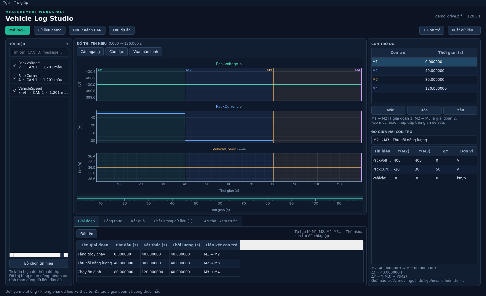
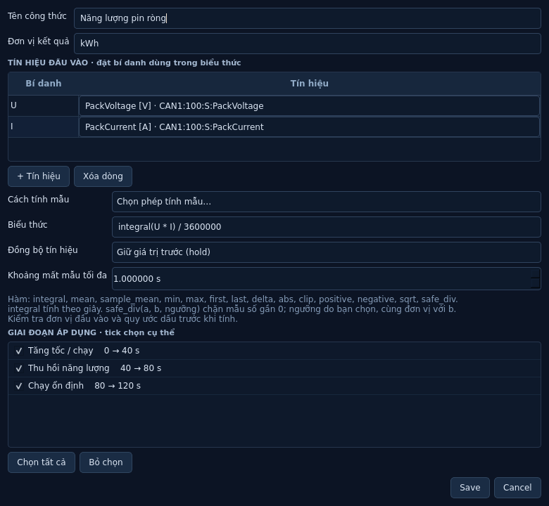

# Vehicle Log Studio

Ứng dụng desktop Python để đọc BLF/MF4, giải mã DBC, chia giai đoạn,
tạo công thức và tính năng lượng theo từng giai đoạn. Giao diện tiếng Việt,
bố cục danh sách tín hiệu → đồ thị → con trỏ, kèm các bảng phân tích bên dưới.

**Muốn sửa giao diện hoặc logic:** xem [CODE_MAP.md](CODE_MAP.md). Mã nguồn đã
được chia theo component; đầu mỗi file có chú thích tiếng Việt về chức năng,
vị trí cần sửa và liên kết với các component khác.



Thiết lập công thức và giai đoạn:



## Lấy dự án từ GitHub

Repository: https://github.com/phamdinhbinh/Vehicle-log-

- Tải ZIP: https://github.com/phamdinhbinh/Vehicle-log-/archive/refs/heads/main.zip
- Hoặc mở terminal và chạy:

```bash
git clone https://github.com/phamdinhbinh/Vehicle-log-.git
cd Vehicle-log-
code .
```

Sau đó làm theo phần cài đặt bên dưới. Mở thư mục chứa `pyproject.toml` trong
VS Code; không cần chép môi trường `.venv` từ máy khác.

## Chạy trên Windows

Cài **Python 3.12 64-bit** có Python Launcher. Giải nén mã nguồn vào thư mục
riêng, mở PowerShell tại thư mục đó:

```powershell
py -3.12 -m venv .venv
.venv\Scripts\python.exe -m pip install -e .
.venv\Scripts\python.exe -m vehiclelog
```

Hoặc chạy `scripts/run_windows.ps1` từ PowerShell nếu chính sách máy cho phép.
Không cần kích hoạt virtualenv. Lần cài đầu cần mạng để tải thư viện.

Nhấn **Demo** để thử log điện áp/dòng điện/tốc độ có giai đoạn thu hồi năng lượng.
Hoặc **Tệp → Mở dự án** và chọn `examples/demo/demo.vls.json` để xem bộ công thức
đầy đủ đã gán cho từng giai đoạn.

## Chạy trên Linux / base environment

```bash
python3 -m venv .venv
.venv/bin/python -m pip install -e '.[test]'
.venv/bin/python -m vehiclelog
```

Giao diện desktop cần phiên đồ họa và thư viện hệ thống Qt phù hợp. Trong base
environment không có màn hình, có thể kiểm tra giao diện bằng offscreen và dùng
CLI cho toàn bộ thao tác chuyển đổi/tính toán. Offscreen không cung cấp cửa sổ
tương tác trong trình duyệt.

```bash
QT_QPA_PLATFORM=offscreen .venv/bin/python -m pytest -q
.venv/bin/python -m vehiclelog demo --directory examples/demo
.venv/bin/python scripts/make_demo_project.py
.venv/bin/python -m vehiclelog analyze examples/demo/demo.vls.json
.venv/bin/python scripts/verify_demo.py --directory examples/my-verification
```

`requirements-lock.txt` ghi lại các phiên bản thư viện đã dùng trong môi trường
kiểm thử. Các script cài đặt mặc định dùng ràng buộc trong `pyproject.toml`.

## Luồng sử dụng

1. **Mở log**, chọn BLF hoặc MF4. Với BLF, gán DBC cho từng kênh.
2. Tìm tín hiệu theo tên/message/CAN ID và tick chọn để xem đồ thị.
3. Thêm con trỏ và kéo mốc hoặc sửa thời gian trong bảng. Mốc tự đánh số
   M1, M2, M3… theo thứ tự thời gian; các mốc không đi xuyên qua nhau.
4. Giai đoạn tự tạo: M1–M2 là giai đoạn 1, M2–M3 là giai đoạn 2… Thêm một
   mốc để chia khoảng, xóa mốc để gộp khoảng, kéo mốc để cập nhật ranh giới.
   Có thể đổi tên giai đoạn; không cần tạo liên kết hoặc nhập ranh giới riêng.
5. Trong **Công thức**, đặt tên, chọn các tín hiệu đầu vào và bí danh, chọn mẫu
   phép tính hoặc nhập biểu thức, đặt đơn vị và tick các giai đoạn áp dụng.
6. **Tính kết quả**. Xem giá trị và trạng thái theo từng cặp công thức–giai đoạn.
   Công thức chuỗi tín hiệu có thể xem bằng chức năng vẽ công thức.
7. **Xuất dữ liệu**: Excel, MF4 tín hiệu hoặc MF4 bản tin CAN thô từ BLF.
8. **Lưu dự án** để giữ tín hiệu, mốc, giai đoạn và công thức. Dữ liệu nguồn
   và DBC vẫn nằm ngoài project JSON; cần sao chép cùng khi chuyển máy.

Khi thay đổi công thức, DBC hoặc ranh giới giai đoạn, kết quả cũ được xóa để
tính lại. Khi mở lại dự án cũng cần tính lại kết quả từ nguồn đang sử dụng.

## Căn đồ thị và đo giữa hai con trỏ

- **Căn ngang**: đưa trục thời gian của mọi tín hiệu về toàn bộ log.
- **Căn dọc**: tự căn trục Y riêng của từng tín hiệu trong vùng thời gian đang xem.
- **Vừa màn hình**: căn cả X/Y; mọi tín hiệu đã chọn có khung nằm trong màn hình.
- Các khung chia đều chiều cao và tự co khi chọn thêm tín hiệu hoặc đổi cỡ cửa
  sổ. Vùng đồ thị không có thanh cuộn; khi chọn nhiều tín hiệu, mỗi khung nhỏ hơn.
- Trong bảng bên phải, chọn **M1 → M2**, **M2 → M3**… để xem `Y đầu`, `Y cuối`,
  `ΔY = Y cuối − Y đầu` của từng tín hiệu và `Δt = t cuối − t đầu`.
- Giá trị đo lấy từ mẫu gốc ngay trước/gặp mốc (hold); hover ô để xem tuổi mẫu.
  Mốc ngoài dữ liệu hoặc mẫu invalid hiển thị `—`, không giả giá trị hoặc ΔY.
- Công thức năng lượng vẫn tích phân theo timestamp gốc từ đầu đến cuối mỗi
  giai đoạn đã tick; các nút căn trục chỉ thay cách hiển thị.

Khi chia một giai đoạn đã gán công thức, hai phần kế thừa lựa chọn đó. Khi gộp,
chỉ kế thừa nếu toàn vùng cũ đã được gán; hãy kiểm tra lại tick giai đoạn sau
khi thay đổi số mốc. Project cũ được chuyển sang các cặp mốc liền kề khi mở GUI.

## Công thức

Mỗi công thức có tên, biểu thức, ánh xạ bí danh → signal key, đơn vị, kiểu
nội suy, khoảng mất mẫu tối đa và danh sách giai đoạn. **Không tick giai đoạn
nào nghĩa là chưa áp dụng**, không tự hiểu là áp dụng cho tất cả.

Giả sử `U` là điện áp **V**, `I` là dòng **A**, `v` là tốc độ **km/h**, timestamp
tính bằng giây và dòng dương là pin xả:

| Tên | Biểu thức | Đơn vị |
| --- | --- | --- |
| Công suất pin, dạng tín hiệu | `U * I / 1000` | kW |
| Năng lượng ròng | `integral(U * I) / 3600000` | kWh |
| Năng lượng xả | `integral(positive(U * I)) / 3600000` | kWh |
| Năng lượng thu hồi, độ lớn dương | `integral(negative(U * I)) / 3600000` | kWh |
| Quãng đường | `integral(v) / 3600` | km |
| Công suất cực đại | `max(U * I / 1000)` | kW |
| Tốc độ trung bình theo thời gian | `mean(v)` | km/h |
| Chênh lệch đầu–cuối | `delta(U)` | V |
| Tiêu thụ, chỉ khi đi hơn 1 m | `100 * safe_div(integral(U * I) / 3600000, integral(v) / 3600, 0.001)` | kWh/100 km |

Nếu xe quy ước dòng dương là nạp, cần đổi dấu dòng trong biểu thức. Năng lượng
được tính tại vị trí đo của tín hiệu; điện áp/dòng pin cho năng lượng tại pin.
Không tự suy ra năng lượng cơ tại bánh xe hoặc nhiên liệu động cơ đốt trong.

Các phép được hỗ trợ: `+ - * / **`, `abs`, `sqrt`, `clip(x, lo, hi)`,
`positive`, `negative`, `integral`, `mean`, `sample_mean`, `min`, `max`,
`first`, `last`, `delta`, `safe_div(a, b, ngưỡng)`. `safe_div` từ chối khi trị
tuyệt đối mẫu số nhỏ hơn hoặc bằng ngưỡng. Số mũ nguyên từ -8 đến 8. `negative(x)` trả về
`max(-x, 0)`, phù hợp báo năng lượng thu hồi dưới dạng độ lớn dương.

`mean` là trung bình có trọng số thời gian. `sample_mean` trung bình tại các
mốc mẫu gốc đã căn chỉnh của các tín hiệu tham gia biểu thức.

Bộ công thức kiểm tra cú pháp bằng danh sách AST cho phép, không thực thi mã
Python tùy ý. Có kiểm tra thứ nguyên cho các đơn vị nhận diện được, **không tự
đổi hệ số V/mV, W/kW hoặc s/h**. Đơn vị lạ được ghi rõ là chưa xác minh.

## Quy tắc thời gian và chất lượng dữ liệu

- Timestamp của BLF được đổi sang giây tương đối với mốc đầu log; mốc Unix
  tuyệt đối được giữ trong metadata. MF4 dùng trục thời gian tương đối trong file.
- Mỗi tín hiệu giữ timestamp gốc; timestamp trùng dùng giá trị cuối. Timestamp
  đi lùi giữa các khối bị từ chối để tránh đưa ra kết quả sai.
- **Hold**: dùng mẫu gần nhất trước mốc, còn hợp lệ nếu tuổi mẫu không vượt
  `max_gap`. **Linear**: chỉ nội suy khi hai mẫu bao quanh cách nhau không quá
  `max_gap`. Không ngoại suy ra ngoài thời gian tín hiệu.
- Tích phân dùng thời gian thực, xử lý các tín hiệu lệch nhịp và ranh giới giai
  đoạn. Hold tích phân trên các khoảng hằng; linear dùng tích phân số có kiểm
  tra hội tụ, xử lý điểm đổi dấu để tách xả/thu hồi.
- Mẫu invalid của MF4 được giữ dưới dạng NaN. Nếu có khoảng thiếu dữ liệu,
  tổng hợp trả về trạng thái `incomplete`, độ phủ và **không công bố tổng thiếu**.
- Chia cho 0 hoặc công thức sai miền trả về `invalid`.
- Công thức chuỗi có trạng thái `trace`, cần vẽ để xem thay vì một giá trị tổng.
- Trong GUI, các giai đoạn là những cặp con trỏ liền kề nên không chồng lấn.
  Backend/CLI vẫn đọc được các phạm vi tùy chọn của project cũ; nếu tự tạo phạm
  vi chồng lấn bằng script, không cộng các hàng đó thành tổng vì sẽ đếm trùng.

## Xuất Excel

- Mỗi tín hiệu có sheet riêng với timestamp gốc (`Time_s`), giá trị, cờ hợp lệ và
  tên giai đoạn. Tín hiệu khác tần số vẫn giữ các thời điểm lấy mẫu riêng.
- Excel luôn giữ mẫu gốc: không nội suy, không ép về một bước thời gian chung,
  không làm tròn timestamp về giây nguyên. Mẫu lỗi có giá trị trống và Valid=false.
- Khi chọn giai đoạn, chỉ lọc mẫu trong khoảng đó; giữ mốc thời gian của log và
  không tạo mẫu ở hai biên. Chỉ cần chọn tín hiệu, toàn log hoặc giai đoạn và nơi lưu.
- Kèm các sheet Summary, Signals, Segments, Formulas, Results và dữ liệu.
- Tự chia sheet khi vượt 1.048.576 hàng.
- Thông tin công thức được ghi dưới dạng văn bản và kết quả đã tính bằng Python.
- Từ chối ghi đè file có sẵn hoặc file nguồn/DBC. Kết quả chỉ được công bố khi
  ghi hoàn tất; file tạm được dọn khi hủy hoặc lỗi.

Excel có thể trở nên quá lớn khi xuất hàng nghìn tín hiệu của log dài. Nên chọn
tín hiệu/giai đoạn cần thiết để giảm kích thước file.

## Xuất MF4

**Tín hiệu đã giải mã:** số thực vật lý, đơn vị, timestamp và invalidation bits.
Mỗi cặp tín hiệu–giai đoạn được đặt trong nhóm riêng, tránh nối giả các vùng
cách nhau. Giữ thời gian nguồn hoặc đưa đầu mỗi giai đoạn về 0. Mốc nguồn và
độ dịch thời gian được ghi trong provenance. Nén MDF4 được bật. Có tùy chọn
kèm công thức dạng chuỗi khi chọn các giai đoạn được đặt tên; chỉ xuất công
thức đã gán cho chính giai đoạn đó. Kết quả tổng hợp như năng lượng ghi trong
bảng Excel/JSON, không bị biến thành tín hiệu đo giả.

**Bản tin CAN/CAN FD thô từ BLF:** cấu trúc ASAM `CAN_DataFrame`, giữ kênh,
CAN ID, IDE, DLC, DataLength, payload, hướng Rx/Tx, EDL/BRS/ESI. Đã có kiểm tra
giải mã lại bằng `asammdf.extract_bus_logging` với DBC. DBC được ghi tham chiếu
trong provenance, không nhúng nội dung DBC vào MF4.

Chế độ thô hiện hỗ trợ **data frame**; gặp remote/error frame trong vùng chọn
sẽ báo lỗi. Các sự kiện logger, LIN, FlexRay, Ethernet và đối tượng BLF khác
không được bảo toàn. Đây là chuyển đổi dữ liệu CAN hỗ trợ, không phải bản sao
lưu trữ đầy đủ mọi đối tượng của BLF. Cần kiểm tra thêm trên phiên bản MDA/
CANape/CANoe thực tế của người dùng.

## Dòng lệnh

```bash
# Xem danh sách tín hiệu; kênh hiển thị bắt đầu từ 1
python -m vehiclelog inspect drive.blf --dbc 1=vehicle.dbc --cache-root ./cache

# Excel một giai đoạn, giữ nguyên các mẫu ghi trong log
python -m vehiclelog convert drive.blf urban.xlsx --format excel \
  --dbc 1=vehicle.dbc --signal VehicleSpeed --segment Urban:10:60

# MF4 đã giải mã, giữ timestamp gốc
python -m vehiclelog convert drive.blf decoded.mf4 --format mf4 --dbc 1=vehicle.dbc

# MF4 bản tin CAN thô, không cần DBC
python -m vehiclelog convert drive.blf raw.mf4 --format raw-mf4

# Tính công thức của project đã lưu, xuất JSON
python -m vehiclelog analyze analysis.vlog.json --output results.json
```

Tên tín hiệu trùng phải dùng **signal key** từ `inspect`. `--dbc` và `--segment`
được phép lặp lại nhiều lần. Lệnh trả mã 1 khi lỗi thao tác, 2 khi có kết quả
tính không hợp lệ/thiếu dữ liệu, 130 khi ngắt bằng bàn phím.

## Dữ liệu lớn và cache

Cache gồm manifest JSON và các file nhị phân float64 cho timestamp/giá trị,
đọc bằng memory mapping. Import/ghi MF4/Excel và tính tổng hợp dùng từng khối;
không chủ động nạp cả log vào RAM. Đồ thị dùng bao min/max và đọc chi tiết
theo vùng zoom; dữ liệu xuất và tính toán luôn dùng mẫu đầy đủ.

Cache phụ thuộc đường dẫn, kích thước, mtime, nội dung lấy mẫu đầu/cuối của
log và toàn bộ nội dung DBC. Đây không phải checksum toàn bộ log; log cần giữ
nguyên khi xử lý. Muốn bỏ qua cache dùng `--force`. Cache cũ không bị xóa khi
tạo cache mới, có thể dọn các thư mục không dùng sau khi đóng ứng dụng.

Đặt `VEHICLELOG_CACHE_DIR` để chọn ổ còn trống. Mặc định là thư mục cache hệ
điều hành; nếu home chỉ đọc sẽ dùng thư mục tạm. Cache giải mã có thể lớn hơn
BLF nén nhiều lần, cần dự trù dung lượng ổ đĩa. RAM còn chịu ảnh hưởng của
thư viện MF4, số tín hiệu và các trang memory map được hệ điều hành giữ lại.

Giá trị giải mã được lưu float64. Bộ đếm/bitfield nguyên 64-bit vượt `2**53`
có thể mất độ chính xác số nguyên; importer ghi cảnh báo riêng theo tín hiệu.
Muốn bảo toàn payload gốc, dùng xuất MF4 bản tin thô trong phạm vi hỗ trợ.

Kiểm tra hiệu năng tổng hợp:

```bash
python scripts/benchmark_store.py --samples 1000001 --chunk 100000
```

Đây là phép thử store/công thức với dữ liệu tổng hợp, không thay thế nghiệm
thu trên BLF 3 GB. Chưa có file thực tế của người dùng để xác nhận tốc độ/RAM.

## Kiểm thử và đóng gói

Kết quả trong base environment: **117 kiểm thử đạt**, kiểm tra dependency không
có xung đột. Chi tiết và số đo tổng hợp tại [VALIDATION.md](VALIDATION.md).

```bash
python -m pip install -e '.[test]'
QT_QPA_PLATFORM=offscreen python -m pytest -q
```

Kiểm thử bao gồm giải mã BLF/DBC thực (Motorola, signed, multiplexing), mapping
kênh, MF4 physical scaling/invalidity, timestamp lệch nhịp, tích phân có đáp án
giải tích, thu hồi, khoảng mất mẫu, bảo vệ công thức, chia sheet Excel, đọc lại
MF4 và thao tác giao diện offscreen.

Để tạo bản Windows, chạy `scripts/build_windows.ps1` **trên Windows**. Kết quả
là cả thư mục `dist/VehicleLogStudio`; sao chép toàn bộ thư mục. Chưa tạo hoặc
kiểm chứng `.exe` Windows trong môi trường Linux này.

## Phạm vi tiếp theo

Nhập MF4 hiện chỉ nhận tín hiệu số vô hướng. DBC chưa được áp dụng tự động khi
mở MF4 bus thô; chuỗi, mảng và sự kiện được báo là bỏ qua. Xem bản tin BLF thô
hiện là preview giới hạn 500 bản tin trong metadata, chưa phải trình duyệt toàn
bộ bus trace.

Các chức năng mở rộng đã đề xuất nhưng chưa thuộc bản đầu: tự tìm/tạo giai đoạn
theo điều kiện, ghi chú sự kiện, so sánh nhiều log, xử lý hàng loạt thư mục,
CSV/Parquet và quản lý nhóm tín hiệu độc lập. Cần nghiệm thu trên dữ liệu thật
trước khi coi ứng dụng sẵn sàng dùng cho kết luận đo kiểm chính thức.

### Con trỏ xem nhanh theo chuột

Bật **Con trỏ xem nhanh** trên thanh căn đồ thị rồi di chuột trong hàng tín hiệu.
Đường đứng thể hiện thời gian chung; chấm sáng và dòng thông tin hiển thị tên,
thời gian, giá trị và đơn vị của tín hiệu đang trỏ. Giá trị lấy từ dữ liệu gốc,
giữ mẫu ngay trước thời điểm chuột và ghi rõ thời gian mẫu. Ngoài phạm vi dữ liệu
sẽ hiển thị dấu —. Con trỏ này không tạo mốc M1/M2, không đổi giai đoạn hay kết quả
công thức. Tắt ô chọn để ẩn con trỏ xem nhanh.

### Thời gian trên đồ thị và trong Excel

Đồ thị dùng timestamp gốc của từng tín hiệu. Khi log lớn, bản xem trước chỉ giảm
số điểm vẽ bằng cách chọn các điểm gốc, giữ thời gian của các điểm đó; thao tác này
không đổi dữ liệu lưu hoặc dữ liệu xuất. Excel luôn xuất toàn bộ mẫu gốc trong
phạm vi đã chọn. Căn thời gian Hold/Linear chỉ còn ở phần tính công thức để xử lý
các tín hiệu khác tần số; không làm thay đổi tín hiệu gốc.

Các tùy chọn xuất Excel cũ `raster`, `interpolation`, `max_gap` và các cờ CLI
`--raster`, `--interpolation`, `--max-gap` đã được bỏ. Script gọi `export_excel`
chỉ cần bỏ các tham số này; cấu hình nội suy trong công thức vẫn giữ nguyên.
